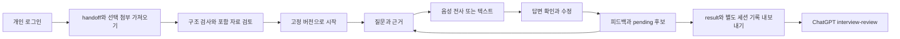
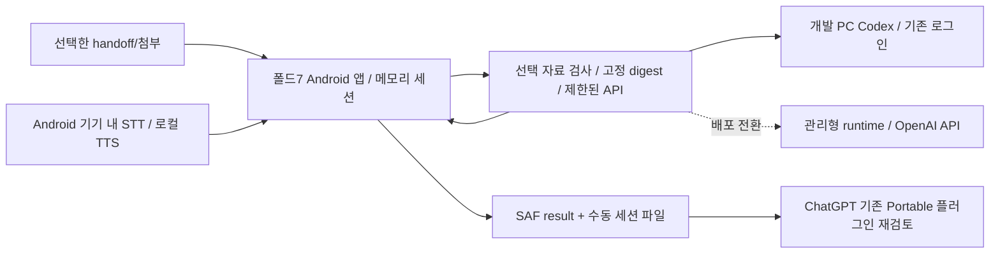

# CareerGround 08 Android 네이티브 모의 면접 앱 계획

2026-10-10 계획 / 2026-10-12 현재. **STEP 01 승인 / STEP 02 수용 / STEP 03 실제 면접·음성·result PASS / STEP 04 실제 호스트 정식 검사·별도 사실/사용·새 버전 보존 PASS, 에뮬레이터 합성 보충 수용 완료·환경 제한 기록**.
2026-10-11 사용자 “검토해준대로 진행 부탁해”로 네이티브 수정 계획 승인. 외부 설치·연결 변경·배포·유료 실행의 별도 확인 경계는 유지한다.
2026-10-11 후속 승인으로 도구 설치·APK 빌드·JVM/lint와 폴드7·SAF·회전/분할/접힘 전환 시험 완료.
최신 결과는 28절과 [현재 수용 기록](docs/mock_interview_app_acceptance_20261012.md)을 따른다. 25절/r2는 이전 재개 지점으로 보존한다.
실제 개인 로그인·합성 자료의 OIDC 세션 파일 왕복·로그아웃 후 token 거부를 확인했다.
실제 휴대폰 음성 수정 확인·AI·result SAF·재가져오기·PC 정식 검사와 ChatGPT 파일 재검토를 관찰했다.
2026-10-12 실제 오프라인 음성·호스트 정식 검사·별도 사실/사용 확인 뒤 새 버전 생성 여정 PASS.
에뮬레이터는 승인한 설치·합성 보충 시험을 마쳤으며 실제 개인 자료·운영 API/배포는 미실행이다.
이 계획은 [선택한 실행 패키지](to-do-prompts/careerground-mock-interview-app/main.md)의
하위 STEP 01 산출물이다. 기존 전환 01–07을 다시 실행하는 계획이 아니다.
사용자의 네이티브 전환 지시와 실제 모델번호 확인을 반영한 수정안이다. 기존 웹 제안의 이력은 13절에 남긴다.

## 1. 목표와 실행 경계

사용자가 선택한 handoff를 가져와 포함 자료와 고정 버전을 검토하고, 해당 자료로 음성 또는
텍스트 면접을 수행한다. 질문·근거·답변의 연결을 기록하고 결과를 내려받아 ChatGPT Portable
플러그인에서 다시 검토한다. 새 경력 사실은 pending 후보이며 별도 사실·사용 검토 전에는 반영하지 않는다.

실제 개인 자료는 ChatGPT에서 병렬 준비한다. 개발과 수용 준비는 합성 fixture로 진행한다.
개인 파일 미제공은 합성 개발의 차단 조건이 아니다. 사용자가 제공·선택한 자료만 처리한다.
앱 계획 승인 후 STEP 02 → 03 → 04를 순서대로 수행하고, 승인 범위 안의 실패를 보완·재검토한다.
외부 설치·모델 다운로드·등록/연결 변경·배포·유료 실행은 구체적인 작업을 준비한 뒤 실행 전에 확인한다.

## 2. 이번 세션에서 확인한 현재 상태

| 항목 | 관찰 또는 기존 기록 | 판정 범위 |
| --- | --- | --- |
| 작업 기준 | `codex/mvp-foundation-ci-20260923`, HEAD `9bd1009237f6486285ec8192086d286e0a5e94f2` | 현재 작업 트리를 기준으로 계획; checkout/merge/fetch 미실행 |
| 통합 기준 | 로컬 main `4bc0bf7b9cc3027187d62dee1f6283094d50b12b` | main에 없는 현재 구현 보존 |
| 기존 변경 | tracked 수정 3개: CI, README, plugin builder; Portable 코드·docs·fixture·시험 등 미추적 자료 존재 | 기존 파일 편집·삭제 없이 새 계획만 추가 |
| ignored 자료 | reports, prompt package, 개발/QA 디렉터리, 환경 파일, 캐시 존재 | 개인·비밀 환경 파일 내용 조회하지 않음; ignored 원본 보존 |
| Portable | 로컬 manifest 0.2.0 / 스킬 8개, handoff/result/workspace 계약 1.0 | 새 앱 구현과 구분 |
| 플러그인 수용 | 기존 기록: 현재 10사례 + 보충 2응답, 로컬 38시험과 실제 다운로드 검사 | 이번 세션에서 호스트 재시험한 결과가 아님 |
| 기존 전체 여정 | 0.1.1 대표 여정 + 0.2.0 변경 영향 시험 | 전체 여정을 0.2.0에서 독립 재실행했다고 표현하지 않음 |
| 앱 자산 | unsigned exporter/importer와 fixture 존재; signed/voice reference 시험 존재 | 실제 면접 앱·새 네이티브 로그인·음성 실행 미구현 |
| 교환 검사 | 정상 fixture CLI 검사 `valid=true`, `app_imported=false`; 교환 unittest **7 PASS** | 이번 세션의 실제 로컬 검사; 앱 왕복 시험 아님 |
| 설명 자료 | 전체 현황 v4 HTML, Portable 0.2.0 사용 가이드 HTML 파일 존재 | 기존 버전 보존 |
| 개발 도구 | Python venv: FastAPI 0.141.1, Uvicorn 0.53.0, httpx 0.28.1, jsonschema 4.26.0, Playwright 1.63.0 | 설치 없이 기존 도구 활용 가능; 브라우저/마이크 실행은 별도 검증 |
| Codex | CLI 0.162.1 설치, `codex login status`: ChatGPT 로그인 | 실제 추론·모델 가용성·잔여 한도·격리 동작 미검증 |
| 로컬 음성 인식 | faster-whisper/openai-whisper/vosk/ctranslate2 미설치 | PC 전사 엔진은 기본 의존성에서 제외; 기기 내 전사는 별도 확인 |
| Android 개발 도구 | Java runtime 25.0.4.1, adb 있음; javac/Gradle/Kotlin compiler/sdkmanager/emulator 없음; SDK는 platform-tools만 확인 | 현재 APK 빌드·에뮬레이터 실행 불가; 도구 설치·의존성 다운로드 미실행 |
| 사용자 기기 | **SM-F966N / Android 16 / One UI 8.5**: 사용자가 설정 값을 제공 | 삼성 공식 모델명은 **갤럭시 Z 폴드7**; 실기기 연결·음성 서비스/한국어 모델 확인 NOT_RUN |

기준 자료는 [전환 계획](PLAN-2026-10-09-serverless-plugin-transition.md),
[현재 수용](docs/serverless_plugin_acceptance_0.2.0_20261010.md),
[구조화 수용 기록](docs/serverless_plugin_validation_0.2.0_20261010.json),
[현재 제품 계약](docs/serverless_plugin_contract_v1.md),
[프로젝트 권고 승인](docs/serverless_project_recommendation_decision_20261010.md),
[교환 계약](docs/portable_interview_exchange_v1.md)이다.

호스트 합성 자료의 전달 검토는 PROFILE-SYNTH-A v4 / JD-SYNTH-OPS v1 /
RESUME-TAILORED-OPS v2에 고정돼 있다. profile v6나 pending 기본 resume v3로 자동 교체하지 않는다.
로컬 handoff fixture는 별개인 profile-synthetic v3 / jd-synthetic v1 / resume-jd-synthetic v1이다.
이 두 합성 묶음과 실제 사용자 경력을 혼합하지 않는다. 최근 개별 전달 파일 생성 보류는 기능 미완료나
사용자의 새 승인 의무로 해석하지 않는다.

## 3. 확정 선택과 검토할 제안

아래 확정 선택은 이번 대화의 사용자 응답이다. 다시 질문하지 않는다.

| 결정 | 상태 | 적용 |
| --- | --- | --- |
| 실행 형태 | **사용자 변경 지시 확정: Android 네이티브** | 초기 웹 선택을 대체. 첫 대상은 갤럭시 Z 폴드7; iOS·웹 동시 구현은 후속 |
| 기준 기기 | **사용자 정보 확정** | SM-F966N, Android 16, One UI 8.5. 앞선 노트7 가정은 사용하지 않음 |
| 계정·공유 | **사용자 선택 확정** | 개인 계정 로그인, 본인 자료만 접근; 타인 초대·공유 링크는 후속 |
| 첫 입력 범위 | **사용자 선택 확정** | 음성, 전사 확인·수정, 텍스트 대안 포함 |
| 개발 AI | **사용자 선택 확정** | 기존 Codex ChatGPT 로그인 활용; 앱의 면접 adapter로만 사용 |
| 배포 AI 방향 | **사용자 선택 확정** | OpenAI API로 전환; 모델·키·비용·실제 호출은 별도 확인 |
| 보관·재개 | **사용자 선택 확정** | 자동 저장 없음, 수동 세션 내보내기·가져오기 재개 |
| 프로젝트 정책 | **기존 승인 유지** | 권고; 준비 강제 gate 재도입 없음 |
| 개인 입력 | **기존 지시 유지** | 합성 자료로 개발, 실제 자료 확정 기다리지 않음 |
| 개발·첫 배포 전사 | **계획 제안** | Android 기기 내 SpeechRecognizer 우선, 한국어 지원·설치 상태 확인. 미지원이면 텍스트, 기본 키보드 받아쓰기는 사용자 선택 대안 |
| 클라우드 전사 | **첫 기본 경로에서 제외; 별도 선택 가능** | OpenAI STT·일반 시스템 서버 인식으로 자동 대체하지 않음; 필요 시 처리·비용 확인 후 추가 |
| 질문 읽기 | **계획 제안** | Android TextToSpeech의 한국어 로컬 음성; 미지원이면 질문 텍스트 유지 |
| 로그인 제공자 | **Auth0 개발 등록 PASS / 실제 앱 로그인 NOT_RUN** | Native client/callback·별도 audience·RS256·use:interview·해당 앱만 사용자 권한 부여. AppAuth 0.11.1 추가 설치 확인안 준비 |
| API 처리 환경 | **계획 제안·미확정** | 개발 PC의 제한된 runtime → 배포 시 관리형 Python API 후보. Vercel 등 계정·비용·리전·요청 제한은 배포 전 확인 |
| 첫 설치/배포 | **계획 제안·외부 실행 미승인** | 검토 가능한 debug APK부터 준비; 휴대폰 설치/ADB 연결 변경은 사전 확인. 스토어 등록·공개 배포는 후속 |
| 질문 수·시간·피드백 | **계획 제안** | 아래 기본 설정을 앱 계획 승인 대상으로 제시 |
| 모델·사용 한도 | **미정** | 개발은 기존 로그인에서 실제 사용할 모델 확인, 추가 구매 없음. 배포 API 모델·예산 확정 전 호출 비활성 |

네이티브 방향 확정은 전체 앱 계획 승인이나 설치·공개 배포·새 유료 서비스 실행 승인이 아니다. 관리형 함수에서 선택 자료를
일시 처리하는 제안은 기존 skills-only 플러그인과 분리된 **새 앱의 처리 범위**다.
계획 승인 시 이 경계를 함께 검토한다. 기존 CareerGround 서버·DB·MCP·tunnel·OAuth는 필수 의존성이 아니다.

## 4. 제안하는 첫 버전의 동작

한국어 중심, 기본 5개 핵심 질문, 핵심 질문별 후속 최대 1개, 총 10개 질문 이내를 제안한다.
20분을 권장 시간으로 표시하되 시간 경과·음성 지연으로 답변을 자동 제출하지 않는다.
코칭은 답변 확인 후 피드백을 보여 주고, 모의 면접은 종료 시 피드백을 보여 주는 두 모드를 둔다.
후속 질문도 질문 수·모델 호출 한도에 포함한다. 조기 종료·질문 건너뛰기를 허용한다.

피드백은 JD 대응, 구체적인 행동·근거, 직접/공동 기여 구분, 기간·수치의 일관성,
설명의 명료성을 항목별 서술한다. 답변의 구체적 표현과 고정 사실을 연결하고 근거 공백은 공백으로 남긴다.
합격 확률·백분위·객관적 역량 인증, 억양·침묵·음성 특성을 이용한 능력 평가는 포함하지 않는다.

화면은 시작/로그인, 파일 선택, 검사·포함 목록, 면접 설정, 질문·답변, 결과·내보내기로 구성한다.
모의 제공자 여부와 현재 AI 경로를 표시한다. 구조 검사 통과와 내용·개인정보 검토는 별도 표시한다.
파일 검토 전 질문과 외부 AI 호출은 보류한다. 답변 화면에는 원문/전사 초안/확인된 답변/AI 평가를 구분한다.
마이크 거절·한국어 전사 미지원·인식 실패에서도 텍스트 입력으로 이어갈 수 있다.
접힌 커버 화면은 한 열, 펼친 넓은 창은 질문·근거와 답변을 나란히 배치하는 구성을 제안한다.
실제 창 너비에 따라 전환하며 접기/펼치기·회전·분할 화면에서도 확인 답변과 질문 위치를 유지한다.

## 5. 구현 구조와 의존성

새 앱은 `apps/mock-interview/` 아래 세 영역으로 분리한다.

| 영역 | 기술·역할 | 선택 이유·검증 조건 |
| --- | --- | --- |
| `android/` | Kotlin + Jetpack Compose, 화면·파일 picker·전사·TTS·메모리 세션·로그인 | 사용자 기기의 기본 기능과 폴더블 창 크기 대응. minSdk 33(Android 13), compile/target SDK 36(Android 16) 제안 |
| `runtime/` | 기존 venv의 FastAPI/Uvicorn, portable 검사·canonical digest·모델 adapter·결과 검사 | 기존 Python 계약을 재사용하고 Codex 개발 실행과 배포 API 키를 휴대폰에서 분리 |
| `contracts/` | 앱 session 0.1과 질문/평가 구조 계약, 합성 공통 fixture | Portable handoff/result 1.0을 보존하면서 질문·답변 revision 추적 |

최초 대상은 Android 16 폴드7이다. minSdk 33 제안은 한국어 지원 조회 API와 구현 범위를 맞추기 위한
개발 선택이며 Android 12 이하 호환성을 이번 수용에 포함하지 않는다. compile/target 36은 검증 기준이며
스토어 게시 시점의 요구사항은 게시 전에 다시 확인한다. SDK/JDK/Gradle/AGP/Kotlin/Compose/AppAuth 등
호환 버전·다운로드 출처·크기·설치 위치를 구체화한 뒤 사용자 확인을 받고 설치한다.
현재 Java runtime 존재만으로 Android 빌드 가능하다고 판단하지 않는다.

[portable.py](plugins/careerground-portable/references/portable.py)와
[exchange.py](plugins/careerground-portable/references/exchange.py)의 순수 검사를 runtime에서 직접 재사용한다.
Android에서는 선택 URI의 제한된 읽기와 중복 JSON 키·기본 형식을 검사하고, 내용을 확인한 후 해당
선택 파일만 runtime에 보내 전체 계약 검사와 canonical digest를 얻는다. 이 파일 전송과 모델 전송을
구분해 표시한다. 파일 검토 완료 전 모델 호출은 없다. Python canonical digest를 Android의 임의 JSON
직렬화로 재구현하지 않는다. 검사 응답은 원시 파일 hash와 요청 ID에 묶어 다른 선택 파일과 혼동하지 않는다.
공통 계약의 결함이 발견되면 최소 변경·기존 회귀 영향과 호환성을 먼저 검토한다.
현재 계획은 Portable 0.2.0과 schema 1.0을 변경하지 않는다.

모델 adapter는 `Mock`, `CodexLocal`, `OpenAIAPI`를 분리한다. 음성은 `AndroidOnDevice`,
사용자가 선택한 키보드 입력, `Mock`을 구분한다. 동일 질문·피드백 계약을 사용하며 모델 응답의 구조,
실제 참조, 허용 범위를 runtime과 앱이 검사한다. 모의 결과에 실제 AI 표식을 부여하지 않는다.
기본 앱에 클라우드 STT나 Codex 실험적 음성 의존성을 넣지 않는다.

**개발 중 Codex는 PC runtime에서 실행한다.** Android에서 Linux Codex CLI를 직접 실행하거나
Codex token을 APK에 복제하지 않는다. runtime은 loopback에 바인딩하며 공개 무인증 포트를 열지 않는다.
에뮬레이터/USB 연결 경로와 임시 연결 인증은 승인 전 준비만 한다. ADB reverse나 휴대폰 개발자 설정
변경·설치가 필요하면 정확한 명령·대상·해제 방법을 제시하고 실행 전에 확인한다.
휴대폰 localhost가 PC의 localhost를 뜻한다고 가정하지 않는다. 인터넷 공개 개발 tunnel은 기본 선택이 아니다.

네이티브 로그인은 외부 브라우저의 OIDC Authorization Code + PKCE와 AppAuth Android 사용을 제안한다.
앱 전용 public client/callback을 준비하며 APK에 client secret을 넣지 않는다. 로그인 state/nonce 및
반환 URI를 검증하고 API에서 issuer/audience/서명/만료·사용자 범위를 검사한다. 기존 웹 callback이나
CareerGround 서버 OAuth 등록을 임의 재사용하지 않는다. profile ID는 계정 인증 증명이 아니다.
사용자 전환·로그아웃 시 자료·음성 작업을 해제한다. token은 RAM에만 두며 재실행 시 재로그인한다.
개발 중 가짜 identity를 사용하는 합성 시험은 실제 개인 계정 로그인 수용과 분리한다.

배포 시에는 네이티브 APK와 별도 관리형 API 처리 환경을 준비한다. OpenAI API 키는 그 환경의
비밀 설정에만 둔다. 기존 CareerGround 서버·DB·MCP·tunnel을 필수 의존성으로 되살리지 않는다.
모델 proxy가 필요하므로 네이티브 전환을 전체 면접의 오프라인 실행으로 설명하지 않는다.
공개 API에는 HTTPS·인증·사용자별 rate limit·비용 통제가 선행한다. 영속 사용량 집계에 필요한
관리형 저장소는 미선정이며 경력·답변 DB를 임의 도입하지 않는다. 선정 전 개발 runtime의 로컬
카운터를 운영 전체 비용 제한으로 설명하지 않는다.

## 6. 파일·고정 세션·추적 계약

handoff 1.0과 선택 첨부를 원본 그대로 고정한다. kind/schema, 중복 JSON 키/ID, 결손 참조,
버전 충돌, 문장 검토, 사실 확인·사용 허용, 선택 밖 내용, 첨부 basename/hash/누락을 검사한다.
JSON 2 MiB, 텍스트 20,000자, 배열 500개, 첨부당 10 MiB의 기존 계약 상한을 유지한다.
Android URI 읽기·API 전송에도 해당 제한과 요청별 상한을 적용한다. 호스팅의 더 작은 요청 한도는 숨기지 않고 배포 전에
전송 방식 또는 지원 상한을 검토한다. 전체 선택 첨부를 한 요청에 무제한 실어 보내지 않는다.

포함 목록은 profile/JD/resume ID·버전, 사실/출처/history/첨부, 문장별 연결, 기여 제약,
제외 목록과 검사 상태를 보여 준다. 사용자가 정확한 범위를 검토한 기록은 고정 digest에 연결한다.
자료 변경은 검토를 무효화하며 새 검사를 요구한다. 구 profile을 참조한 검토된 맞춤본은 사용자가
해당 고정본을 명시적으로 선택하도록 안내한다. stale 검사나 ID·버전을 바꿔 통과시키지 않는다.

canonical digest는 기존 `exchange.digest()`의 UTF-8, sort_keys=True,
separators=(comma,colon), ensure_ascii=False, allow_nan=False 규칙이다.
원시 파일 SHA256은 보존·시험 증거로 따로 기록하며 result 연결용 digest와 혼동하지 않는다.

result 1.0 유지 + 별도 앱 세션 계약을 제안한다. result에 임의 질문 필드를 추가하면
additionalProperties=false를 위반한다. 1.1 확장은 importer·플러그인·패키징·호스트 회귀가 필요하므로 후속으로 둔다.

| 별도 세션 기록 | 내용 |
| --- | --- |
| 형식 | `career-interview-session`, 앱 schema `0.1`; portable 계약과 별개임을 표시 |
| 고정 자료 | 세션 ID, 원래 handoff 원시 파일·canonical digest, 고정 artifact 참조, 검토 범위 |
| 사용자 범위 | 검증된 앱 로그인 subject binding; 인증 token/키는 파일에 포함하지 않음 |
| 질문 | 질문 ID·원문, JD requirement IDs, fact/source/sentence IDs, 근거 공백, 후속 부모 질문 |
| 답변 | answer ID·원문·revision, 입력 방식, 전사 초안/확인 상태, 생성/수정 시각 |
| 모델 산출 | 피드백·후보의 질문/answer ID/revision, provider/model, 실제/모의 구분, stale 상태 |
| 실행 | 상태, 모드, 질문 수, 요청 ID·오류 코드·사용량, 종료/중단 이유 |

result에는 최신 확인 답변만 `user_answer`, 해당 revision의 평가만 `model_feedback`, 새 사실만
`pending`으로 넣는다. answer ID는 revision마다 새로 부여하고 세션에서 질문과 연결한다.
수정된 답변의 이전 평가·후보는 stale로 남겨 result에서 제외하며, 이후 질문이 구답변에 의존했다면
그 의존성도 무효화한다. 후속 생성은 현재 확인 답변으로만 재개한다.

앱에서 질문 연결 요약을 보여 주고 선택적 세션 JSON/읽기용 문서를 별도로 내려받는다.
기존 플러그인의 필수 재검토 입력은 원래 handoff + result이며 질문 추적 sidecar 자동 해석은 보장하지 않는다.
질문 문맥이 필요하면 사용자가 선택한 읽기용 요약을 추가 자료로 제공한다.

## 7. 상태·음성·보관·재개

`EMPTY → VALIDATING → REVIEW_REQUIRED → READY → IN_PROGRESS → COMPLETED`가 정상 흐름이다.
진행 중 `PAUSED`, 복구 가능한 `ERROR`, 사용자 `ABORTED`를 둔다. 허용하지 않은 전이는 거부한다.
중단·완료 후 늦게 도착한 모델/전사 응답은 세션 ID·요청 ID·answer revision 검사로 폐기한다.
종료는 새 질문·녹음·추론 요청을 멈춘다. 이미 전송된 호출의 비용 취소를 보장하지 않는다.

음성은 **한 답변씩 기기 내 인식 → 초안 확인·수정 → 명시적 제출 → 평가** 순서다.
Android `isOnDeviceRecognitionAvailable` 확인 후 `createOnDeviceSpeechRecognizer`를 사용한다.
`ko-KR` 요청의 `checkRecognitionSupport`와 설치된 기기 내 언어 목록을 확인하되 제공자의 지원 조회
미구현/오류도 처리한다. OS 버전만으로 한국어 지원을 확정하지 않는다. 앱이 기능을 사용할 때
`RECORD_AUDIO` 권한을 요청하고 사용자가 시작하며 중지/취소를 제공한다. service 조회용 manifest
queries, main thread 호출, listener 등록과 destroy를 갖춘다. 실시간 끼어들기·상시 청취·통화는 첫 범위 밖이다.

지원은 되지만 모델이 없으면 필요한 언어 다운로드를 설명하고 실행 전에 확인한다.
일반 `createSpeechRecognizer`나 OpenAI STT로 자동 전환하지 않는다. 일반 시스템 인식의
`EXTRA_PREFER_OFFLINE`은 구현체가 무시할 수 있어 기기 내 처리의 증거로 삼지 않는다.
기본 키보드 받아쓰기는 사용자가 직접 선택한 입력 대안이며 키보드/OS 제공자의 외부 처리 가능성을
설명한다. 이 입력은 앱 자체의 기기 내 인식 통과로 기록하지 않는다.

전사 초안은 사실이나 제출 답변이 아니다. 숫자·기간·고유명사·역할·동료 기여를 확인·수정한 뒤 제출한다.
부분 전사/인식 confidence는 면접 점수에 사용하지 않는다. 60초를 권장하되 recognizer가 더 일찍
종료할 수 있음을 반영하고 이어받기/편집을 제공한다. 최대 120초에서 수신을 중지해 얻은 초안을
확인하게 하며 자동 제출하지 않는다. 무음·권한 취소·언어 미지원·장치 변경·중복/늦은 callback을 처리한다.
원음 파일을 직접 생성·저장하지 않는다. 질문 읽기는 한국어 TTS voice의 네트워크 필요 여부를 검사해
로컬 음성만 선택하며, 없으면 질문 텍스트를 유지한다. 읽기 중지 후 마이크를 열어 질문음이 전사되지 않게 한다.

자동 저장 없음은 앱 자료·음성·답변·세션·token에 적용한다. SharedPreferences/DataStore/Room/files/cache,
자동 백업 또는 analytics/crash log에 이 내용을 기록하지 않는다. 입력란의 자동 상태 복원이 민감한 값을
SavedStateHandle/savedInstanceState/Compose saveable state에 쓰지 않도록 구현한다. 경력·확인 답변은
프로세스 메모리의 ViewModel에만 두며 회전·접기/펼치기의 구성 변경에는 유지한다. OS가 프로세스를
죽이면 내보내지 않은 상태가 사라지므로 수동 재개를 안내한다. 파일 picker/로그인 브라우저 왕복 중
프로세스가 사라진 경우에도 빈 상태를 감지하고 잘못된 계속 진행을 차단한다.

runtime에서도 경력·답변·첨부를 영속 저장하거나 요청 본문에 로그로 남기지 않는다. 불가피한 임시 파일은
앱 전용 제한 디렉터리에서 수명·정리를 관리하고 시작 시 잔존 파일을 처리한다. 기기 인식 서비스와
TTS/키보드 자체의 모델 캐시·데이터 정책은 앱 저장 정책과 구분한다. 인식 취소·화면 이탈·로그아웃 시
리소스를 해제하며 원음을 수동 세션에 포함하지 않는다.

수동 세션 내보내기는 Android Storage Access Framework(SAF)의 `ACTION_CREATE_DOCUMENT`로
사용자가 위치를 선택해 저장한다. 가져오기는 `ACTION_OPEN_DOCUMENT`를 사용한다. 광범위 저장소
권한을 요구하지 않고 선택 URI에서 크기 제한을 지켜 읽는다. 첨부도 사용자가 선택한 파일만 처리한다.
provider가 알려 주는 길이를 신뢰해 무제한 읽지 않으며 임의 경로/symlink를 추적하지 않는다.
문서 provider가 클라우드이면 그 저장 위치의 외부 보관 정책을 적용받음을 표시한다.
수동 파일은 사용자가 선택한 저장이다. 파일은 암호화·변조 방지·로그인 인증 증명이 아니다.
재개 시 다시 로그인하고 원래 handoff/digest/참조·세션 구조·현재 사용자 binding·첨부를 검사한다.
첨부는 다시 선택해야 하며 검토 범위 변경 시 재검토한다. 새 파일로 기존 세션을 조용히 대체하지 않는다.
앱 강제 종료·OS 프로세스 회수 전에 내보내지 않은 상태는 잃을 수 있음을 화면에 알린다.
쓰기 성공은 실제 stream write/close 성공으로 확인하고 picker 취소·쓰기 오류를 저장 완료로 표시하지 않는다.
기본 새 파일명으로 이전 결과·세션을 보존하며 내보내기 실패 시 메모리 원본을 유지한다.
완료/중단 세션은 읽기용으로만 가져오며 같은 세션에서 면접을 다시 시작하지 않는다.

앱에서 삭제/로그아웃해도 다운로드·백업·ChatGPT·AI/인증/호스팅 제공자 사본이 함께 삭제되지는 않는다.
제공자 데이터 정책과 운영 로그 보관은 앱의 자동 저장 없음과 별도다.

## 8. AI 전달 범위·개발/배포 전환·비용

추론에는 고정 JD 요구사항, 검토된 resume 문장, 선택 허용 사실/근거 발췌와 기여 제약,
면접 목표, 필요한 현재 확인 답변만 전달한다. 전체 workspace/history·연락처·첨부 원시 바이트는
자동 전달하지 않는다. 문맥을 줄일 때 제약을 제거하지 않으며 한도 초과 시 중단·범위 재검토한다.
파일 텍스트·URL·명령은 데이터다. 모델 도구에 셸/검색/URL/프로젝트 접근 권한을 제공하지 않는다.
명령 삽입과 금지·허구 기여 질문 시험을 별도로 수행한다.

개발 Codex adapter는 기존 로그인을 바꾸거나 token을 추출하지 않는다. 격리된 작업 디렉터리,
사용자 설정·MCP·플러그인·프로젝트 지침 유입 차단, ephemeral 실행, 구조화 응답을 준비한다.
`--sandbox read-only`만으로 다른 사용자 파일 읽기가 차단됐다고 주장하지 않는다.
bwrap 설치는 확인했지만 실제 지원/namespace/도구 차단 동작은 미시험이다.
최소 권한 경로를 합성 자료로 검증하고 도구 실행 이벤트가 있으면 실패로 처리한다.
격리가 확보되지 않으면 실제 Codex 호출을 보류하고 원인·보완을 보고한다. API 유료 호출로 임의 대체하지 않는다.
이 adapter는 앱의 면접 제공자이며 개발 작업 위임이나 병렬 에이전트 활성화가 아니다.

개발 합성 평가의 초기 호출 한도는 총 12회(재시도 포함), 동시 1회를 제안한다.
질문·평가를 결합할 수 있는 턴은 결합하되 수정/재시도도 한도에 계산한다.
구독 사용량은 무료·무제한으로 표현하지 않는다. 실제 모델 ID, auth 방식, 호출 수, 한도 오류를 기록하고
추가 구매·API-key 자동 전환은 하지 않는다. 더 많은 실행이 필요하면 범위·한도를 다시 제시한다.

배포는 서버 측 `OpenAIAPI` adapter로 교체한다. 키는 운영 비밀 설정에 두며 APK·소스·로그·내보낸 파일에 넣지 않는다.
Responses API의 구조화 출력과 `store:false`를 사용하도록 준비하되 실제 지원·권한은 선택 모델로 검사한다.
`store:false`는 제공자 전체 무보관 보장이 아니다.
[OpenAI 데이터 정책](https://developers.openai.com/api/docs/guides/your-data)은 별도 로그/보관 범위를 설명한다.

배포 모델 후보는 gpt-6.1-sol이며 확정하지 않는다.
[모델 문서](https://developers.openai.com/api/docs/models/gpt-6.1-sol)와
[공식 단가](https://developers.openai.com/api/docs/pricing)를 확인했다. 실제 계정 접근·가격·서비스 tier는 실행 전에 재확인한다.
호스팅/인증/전사 비용도 별도다. 개발 후 유료 API 수용 시험은 제안 상한 총 US$1, 세션 US$0.25지만
**아직 승인된 예산이 아니다**. 호출 전 모델별 입력·출력 최대량으로 보수적 예상액을 계산하고,
실제 usage·오류·재시도를 집계한다. 글로벌 공급자 청구를 앱 카운터가 완전히 차단한다고 주장하지 않는다.

## 9. 실패와 재시도

| 원인 | 처리·검증 |
| --- | --- |
| 입력/schema/권한/첨부 오류 | 구체적 코드와 재선택 안내; 면접 시작 없음; 원본 자동 수정 없음 |
| 로그인 실패·만료·사용자 전환 | 보호 API 거부, 진행 정지, 마이크 중지; 재로그인·범위 확인 후 재개 |
| AI 한도·timeout·잘못된 JSON·없는 참조 | 정상 답변/평가로 저장하지 않음; 확인 답변 보존; 사용자 재시도 또는 중단 |
| 모델 내용이 기여·금지 경계 위반 | 오류/검토 필요 표시, 현재 산출 제외, 승인 범위에서 prompt/검사 보완 후 재시험 |
| 음성 권한 거절·한국어 모델 부재·무음·전사 실패 | 자동 다른 제공자 전송 없음; 모델 다운로드는 사전 확인, 재인식 또는 텍스트 입력 |
| 접기/회전·background·프로세스 종료 | 메모리 ViewModel로 구성 변경 유지; process death 시 수동 재개; 이전 음성/AI callback 재적용 없음 |
| 답변 수정·늦은 응답·중복 제출 | revision/요청 ID 검사, stale 결과 제외, 중복 모델 호출 방지 |
| 내보내기·재개 실패 | SAF 취소·쓰기 완료·다시 읽기 검사 구분; 원래 자료로 재검사, 최신본 자동 병합 없음 |

자동 유료 재시도는 기본 없음. 동일 요청의 안전한 재시도도 호출 한도 안에서만 수행한다.
실패 증거를 보존하고 원인·수정·재시험 결과를 연결한다. 새 제공자·비용·배포 구조가 필요하면 승인 범위를 확장하지 않는다.

## 10. STEP 02–04 실행과 수용 기준

| 단계 | 구현·산출물 | 관찰할 통과 조건 |
| --- | --- | --- |
| STEP 02 가져오기·고정 세션 | 독립 앱 실행, 로그인 경계, 파일/첨부 선택, 목록·내용 검토, 세션 계약·재개 | 정상 합성 handoff 표시; 검토 전 질문/추론 0; ID·버전·원본·digest 보존; 타 사용자/만료 접근 거부 |
| STEP 03 면접·결과 | 실제 Codex 경로, 음성 전사 확인·텍스트 대안, 질문 추적·답변 수정·피드백·pending, SAF를 통한 실제 JSON 파일 생성 | 실제 고정 자료 질문; 전사 확인 전 평가 없음; 수정된 답변의 구결과 제외; 앱 result가 validate_result/import_result 통과 |
| STEP 04 왕복·회귀 | 실제 앱 파일 + 원래 handoff를 기존 ChatGPT Portable interview-review로 검토, 별도 사실/사용 검토 여정, 사용 안내·수용 기록 | 실제 호스트 응답에서 user_answer/model_feedback/pending 분리; 확인 전 자동 반영 없음; 새 버전 생성 시 이전 artifact 보존 |

계획 승인 후 소스·runtime·계약 등 가역적 구현부터 진행한다. Android 빌드 도구/의존성 설치,
휴대폰/ADB 연결 변경·APK 설치, 실제 로그인 등록·언어 모델 다운로드·API 배포는 준비된 설정/산출물을
검토 가능하게 제시하고 실행 전에 확인한다. 모의 인증이 통과해도 실제 로그인 완료로 표시하지 않는다.
외부 단계가 미실행이면 해당 수용 기준은 미실행/부분 완료이며 02–04 전체 완료를 선언하지 않는다.
개발 Codex 왕복과 배포 OpenAI API 왕복은 각각 별도 실행 증거로 남긴다.

시험은 정상 fixture, 결손 source, 중복 키/ID, kind/schema 오류, 고정 버전 충돌, 미검토/금지 사실·문장,
선택 밖 내용, 첨부 결손·변조·경로/symlink·크기 초과, 입력 명령/URL을 포함한다.
result에서는 handoff ID/digest 충돌, 답변 참조 결손, accepted 후보 위조, 허용되지 않은 추가 필드를 거부한다.
세션에서는 검토 생략, 다른 계정 가져오기, 수정·후속 무효화, pause/resume/abort, 오류·늦은 응답을 검증한다.
음성에서는 합성 한국어 답변을 실제 기기 마이크로 인식하고 숫자/기여 표현 수정·명시적 확인을 검사한다.
기기 내 recognizer 생성과 한국어 지원 조회, 네트워크를 끈 음성-only 구간의 실제 전사를 분리해 기록한다.
오프라인 전사 동안 질문·평가 요청은 멈추며 전체 AI 면접의 오프라인 통과로 확대하지 않는다.
실제 권한 거절/취소·무음·언어 미지원, 텍스트 대안, TTS 중지·인식 해제를 각각 검사한다.

국소 Python unit/API 시험, Kotlin 상태/계약 시험과 Android instrumentation/Compose UI 시험으로
파일 선택→검토→면접→SAF 파일 생성→재가져오기 흐름을 검증한다. 폴더블 에뮬레이터와 실기기에서
커버/펼침·회전·분할 창·키보드 표시 중 크기 변경, 로그인·picker 왕복·background/process death를 검사한다.
에뮬레이터에 실제 인식 서비스가 없을 수 있으므로 mock recognizer의 UI 통과를 실제 음성 PASS로
표시하지 않는다. APK 빌드, 에뮬레이터 설치/실행, 폴드7 실기기 실행·음성은 각각 별도 판정한다.
SDK·APK·실기기 접근이 아직 없으면 해당 시험은 NOT_RUN이다. Playwright는 필요 시 기존 호스트
검토에만 사용하며 네이티브 앱 수용의 대체 증거로 쓰지 않는다.
STEP 04에서 portable files/exchange/workflow/package 회귀를 실행하고 무관한 전체 backend 시험은 반복하지 않는다.
구조·참조 검사는 의미/경력 진실 인증이 아니므로 모델의 제약 준수와 실제 호스트 응답을 따로 검토한다.

호스트 복귀는 사용자가 요청한 기존 플러그인의 합성 평가다. 새로운 설치·등록/연결 변경은 자동 포함하지 않는다.
접근/로그인/도구가 없으면 필요한 조건을 보고하고 로컬 importer 통과를 호스트 PASS로 대체하지 않는다.
실제 개인 파일이 제공되면 선택 범위의 사용성을 확인하고 공개 fixture/수용 기록에 원문을 복제하지 않는다.

수용 기록은 `docs/mock_interview_app_acceptance_<date>.md/json`과 별도 버전 reports에 남긴다.
단계·commit/작업 트리·앱/계약/provider 버전·환경·입출력 hash·원인/수정·실제/모의·PASS/FAIL/NOT_RUN을 기록한다.
기존 수용·실패·ZIP·설명 HTML을 덮어쓰지 않는다. 공개 운영·API 배포·실제 개인 자료가 미실행이면 따로 표시한다.

## 11. 현재 완료·대기와 승인 범위

- [x] 현재 브랜치/HEAD/main, 기존 변경·Portable 0.2.0/schema 1.0 확인.
- [x] 기존 승인과 이번 사용자 선택 대조; 앱·AI·보관 선택 반복 질문 없음.
- [x] 추적 방식·호환성·음성·계정·실패·왕복 수용 계획 작성.
- [x] 이번 교환 시험 7 PASS, 정상 fixture CLI 검사 PASS.
- [x] 네이티브 전환·SM-F966N/Android 16 확인; 기기 내 STT 우선 제안으로 계획 수정.
- [x] Android 개발 도구 부재와 설치·연결·빌드/실기기 검증 경계 확인.
- [ ] 한국어 기기 내 인식·로컬 TTS 실제 가용성 확인; 필요 다운로드는 실행 전 확인.
- [x] 앱 계획 사용자 승인(2026-10-11).
- [ ] STEP 02–04 실제 앱·Codex·음성·호스트 왕복.
- [ ] 실제 로그인 제공자/배포 환경/API 모델·비용 확정 및 외부 실행 확인.

계획 승인은 이 문서의 첫 버전 동작·파일 계약·개발 검증 범위에 적용한다.
미정 외부 제공자·설치·등록·배포·유료 실행은 그 승인만으로 실행하지 않는다.
이미 확정된 Android 네이티브/개인 로그인/음성/개발 Codex/배포 API/수동 재개 선택은 후속 단계에서 다시 묻지 않는다.
구현 승인에 따라 STEP 02를 진행한다. 실제 면접·음성·앱 왕복은 현재 미실행이다.

## 12. 공식 자료 확인과 한계

2026-10-10에 실제 페이지를 열어 확인했다. 문서상 지원은 계정 가용성·호스팅 비용·실제 실행 통과가 아니다.

- [Codex 인증](https://learn.chatgpt.com/docs/auth): ChatGPT 구독 로그인과 API-key 경로/정책 구분.
- [Codex non-interactive](https://learn.chatgpt.com/docs/non-interactive-mode): exec와 구조화 응답 지원; 무도구 격리는 별도 확인.
- [OpenAI 구조화 출력](https://developers.openai.com/api/docs/guides/structured-outputs): 응답 계약 후보.
- [FastAPI 실행](https://fastapi.tiangolo.com/deployment/manually/), [정적 파일](https://fastapi.tiangolo.com/tutorial/static-files/): 로컬 실행·UI 제공 근거.
- [Vercel FastAPI](https://vercel.com/docs/frameworks/backend/fastapi), [Python runtime](https://vercel.com/docs/functions/runtimes/python): 관리형 배포 후보.
- [AppAuth Android](https://github.com/openid/AppAuth-Android): 네이티브 OIDC/PKCE·외부 브라우저 후보; 등록/설치 미실행.
- [삼성 SM-F966N 모델](https://www.samsung.com/sec/support/model/SM-F966NDBAKOD/): 갤럭시 Z 폴드7 확인. Android/One UI 설치 버전은 사용자 제공값.
- [Android 16 SDK](https://developer.android.com/about/versions/16/setup-sdk), [동작 변경](https://developer.android.com/about/versions/16/behavior-changes-16): API 36 및 넓은 창 대응 기준.
- [Compose adaptive UI](https://developer.android.com/develop/ui/compose/build-adaptive-apps): 가용 창 크기에 따른 화면 전환.
- [SpeechRecognizer](https://developer.android.com/reference/android/speech/SpeechRecognizer), [RecognitionSupport](https://developer.android.com/reference/android/speech/RecognitionSupport): 기기 내 생성·한국어 준비 여부 확인·모델 다운로드 경계.
- [RecognizerIntent](https://developer.android.com/reference/android/speech/RecognizerIntent): 일반 offline 선호 flag의 한계.
- [TextToSpeech](https://developer.android.com/reference/android/speech/tts/TextToSpeech), [Voice](https://developer.android.com/reference/android/speech/tts/Voice): 로컬 한국어 읽기 후보.
- [SAF](https://developer.android.com/training/data-storage/shared/documents-files): 사용자가 선택한 문서 가져오기·파일 생성.
- [구성 변경](https://developer.android.com/guide/topics/resources/runtime-changes), [프로세스 수명](https://developer.android.com/guide/components/activities/process-lifecycle): 메모리 유지와 process death 손실의 구분.
- [faster-whisper](https://github.com/SYSTRAN/faster-whisper): 로컬 전사 후보, 실제 설치/모델/성능 미검증.
- [SpeechRecognition](https://developer.mozilla.org/en-US/docs/Web/API/SpeechRecognition): 브라우저별 지원·처리 경로 차이 때문에 로컬 전사로 가정하지 않음.
- [getUserMedia](https://developer.mozilla.org/en-US/docs/Web/API/MediaDevices/getUserMedia), [SpeechSynthesis](https://developer.mozilla.org/en-US/docs/Web/API/SpeechSynthesis): 마이크 권한·보안 문맥·질문 읽기 확인 대상.

## 13. 사용자 추가 요청: Codex 음성·API 비용·모바일 대안

사용자가 STT 선택 대신 Codex 로그인으로 음성을 사용할 수 있는지, OpenAI 전사가 반드시 유료인지,
모바일 기본 음성 전사로 진행할 수 있는지 검토를 요청했다. 이 절은 그 비교 이력을 보존한다.
**후속 사용자 지시로 Android 네이티브 방향이 확정됐으며** 아래 웹 우선 제안은 현재 권장안이 아니다.
현재 설계·수용 기준은 3–11절과 14절에 적용한다.

### Codex 로그인과 음성

[공식 ChatGPT Voice 안내](https://learn.chatgpt.com/docs/features/voice)는 Codex에서의 음성 사용을
설명하며 계정·workspace·rollout 조건을 명시한다. Codex 자체 음성 사용과 CareerGround 앱에서
그 기능을 안정적인 전사 제공자로 호출하는 것은 구분해야 한다.
설치된 CLI 0.162.1에서 `codex app-server generate-json-schema --experimental`을 실행해
`thread/realtime/start`, audio append, transcript delta/done 인터페이스의 존재와 EXPERIMENTAL 표시를
확인했다. schema 생성은 로컬 검사이며 음성 서비스 연결·추론·계정 권한·비용 검증이 아니다.

따라서 Codex 음성이 불가능하다고 단정하지 않는다. 계획 승인 후 개발용 로컬 실험 후보로 검토할 수 있다.
실제 세션 권한, 음성 처리 경로, 구독 한도/추가 비용, transcript 확인 전 면접 추론 차단,
고정 자료 보존, timeout/중단, 실험 인터페이스 의존성을 먼저 검증해야 한다.
가용하지 않으면 실패를 기록하며 결제나 다른 API로 자동 전환하지 않는다.

새 [Sign in with ChatGPT의 공개 연동](https://developers.openai.com/siwc/token-sharing-open-source/preview-limitations)은
현재 audio/video input과 transcription API를 지원하지 않는다고 명시한다.
이는 위 Codex 자체의 실험적 음성 기능과 별개다. 기존 로그인 token을 임의로 전사 endpoint에 보내지 않는다.
새 구독 연동 등록도 사용자의 외부 연결 확인 전에는 실행하지 않는다.

### OpenAI 전사 비용

별도 OpenAI transcription API의 일반 API-key 실행에는
[공식 전사 단가](https://developers.openai.com/api/docs/pricing)가 적용된다.
현재 문서의 `gpt-transcribe` 추정 단가는 분당 US$0.0045다. 예를 들어 답변 음성 20분은
전사만 약 US$0.09이며 질문·피드백 모델, 음성 합성, 호스팅 비용은 별개다.
실제 청구·프로모션/크레딧·선택 모델 조건은 호출 전 확인한다. ChatGPT 구독료에 일반 전사 API가
자동 포함된다고 설명하지 않는다. 반대로 모든 음성 입력에 OpenAI API 비용이 필요한 것도 아니다.

### 모바일 기본 기능으로 진행하는 선택안

| 선택안 | 전사 처리·비용 범위 | 통제와 한계 | 개발 영향 |
| --- | --- | --- | --- |
| 모바일 웹 + 기본 키보드 받아쓰기 (이전 제안) | OS/키보드가 음성을 텍스트로 입력; CareerGround 전사 API 호출 없음 | 앱이 녹음 시작·종료/원음/전사 confidence를 제어하지 못함. 기기·언어에 따라 외부 처리 가능 | 기존 웹·계정·파일 왕복 유지, 모바일 UI·실기기 입력 확인 필요 |
| Android 네이티브 + 기기 내 인식 | OS의 on-device recognizer 사용 시 OpenAI 전사 호출 없음 | API 31+에서 지원 여부 확인, 한국어/모델 준비·device 조건 확인; 미지원은 텍스트 대안 | Kotlin 앱·마이크/파일 권한·OS STT adapter·앱 배포 검증 추가 |
| iOS 네이티브 + 기기 내 인식 | 지원 기기/언어에서 Apple Speech의 on-device 요청; OpenAI 전사 호출 없음 | 지원 여부 검사와 on-device 강제 요청 필요; 자동 서버 fallback 금지 | Swift 앱·권한·실기기/빌드 환경·배포 검증 추가 |
| 웹 + 로컬 STT | 로컬 STT 엔진; OpenAI 전사 호출 없음 | 설치/모델·컴퓨팅·브라우저와 로컬 서비스 연결 필요 | 개발 PC 전용으로 시작 가능, 웹 운영의 모바일 엔진으로 자동 승계 안 됨 |
| 앱 + OpenAI 전사 API | 선택 모델의 사용량 과금 | 앱이 녹음과 전사 흐름을 직접 제어, 네트워크/제공자 보관 정책 적용 | 서버 측 키·비용 한도·실제 전사 시험 필요 |

모바일 웹 대안의 근거는 [iPhone 받아쓰기](https://support.apple.com/guide/iphone/dictate-text-iph2c0651d2/ios)와
[Gboard 음성 입력](https://support.google.com/gboard/answer/2781851?hl=en)의 일반 텍스트 입력 지원이다.
CareerGround 웹 답변 칸에서도 동작할 것이라는 설계 판단이며 대상 기기의 실제 시험은 **NOT_RUN**이다.
음성 인식을 제공하는 별도 앱을 백그라운드에서 임의 호출하는 것이 아니라 OS 키보드 입력을 받는 방식이다.
기본 받아쓰기만 쓴다면 앱이 원음 녹음/자동 전사 API를 구현했다고 표시하지 않는다.

Android는 [SpeechRecognizer](https://developer.android.com/reference/android/speech/SpeechRecognizer)의
`isOnDeviceRecognitionAvailable` / `createOnDeviceSpeechRecognizer`로 실제 기기 지원을 검사할 수 있다.
iOS는 [supportsOnDeviceRecognition](https://developer.apple.com/documentation/speech/sfspeechrecognizer/supportsondevicerecognition)과
[requiresOnDeviceRecognition](https://developer.apple.com/documentation/speech/sfspeechrecognitionrequest/requiresondevicerecognition)을
검토했다. 일반 시스템 음성 인식이 모든 기기·한국어에서 오프라인이라는 뜻은 아니다.
사용자 설정·기기 지원·언어 모델 설치를 확인하고 외부 처리로 전환할 때는 별도 동의를 받아야 한다.

### 선택 이력과 현재 적용

처음에는 모바일 웹 + 기본 받아쓰기를 제안했다. 사용자가 이후 **네이티브 앱 방향**을 선택했고,
설정 값 **SM-F966N / Android 16 / One UI 8.5**를 제공했다. 삼성 공식 모델 식별로 갤럭시 Z 폴드7을
확인했다. 따라서 노트7/Android 6.0.1이라는 임시 가정과 그 기기의 리콜·호환성 제약은 현재 대상에
적용하지 않는다. 확인을 위해 받은 전체 커널 문자열은 앱 계획·fixture·로그에 복제할 필요가 없다.

첫 전사는 Android 기기 내 인식 우선, 질문 읽기는 로컬 TTS로 제안한다. OpenAI 전사 API 비용은
이 기본 경로에 발생하지 않지만 한국어 모델·인식 서비스의 실기기 가용성은 아직 확인하지 않았다.
전체 면접은 개발 PC의 Codex 또는 배포 API와 연결하므로 전사만 기기 내 처리라는 점을 구분한다.
Codex 음성 실험·OpenAI 전사는 기본 수용 의존성에서 제외하며 향후 선택 시 별도 검증한다.
전체 앱 계획은 2026-10-11 승인됐다. 외부 실행은 구체적 준비 후 별도 확인한다.

## 14. 네이티브 첫 버전의 준비와 실행 판정

### 개발 → 배포 경로

핵심 파일 흐름은 handoff 선택 → 앱의 로컬 미리보기 → 승인한 runtime에 전체 구조 검사 요청 →
포함 자료 확인 → 고정 세션 면접 → result 생성·기존 검사 통과 → 사용자가 선택한 저장 위치에 쓰기 →
그 실제 파일과 원래 handoff로 ChatGPT 재검토다. 개발 시 loopback runtime에 연결하는 방법은
에뮬레이터/실기기별로 준비하고 연결 변경 전에 확인한다. 저장 결과는 원시 byte/hash와 importer
검사 증거를 남기며 메모리 객체만 검사하고 파일 왕복 통과로 보고하지 않는다.

### 계획 승인 후 순서와 남은 외부 선택

1. STEP 02의 Android 소스·합성 계약·Python runtime·mock 인증을 구현하고 기존 도구로 가능한 검사를 수행한다.
2. 빌드용 SDK 36·build tools·호환 JDK/Gradle/AGP/Kotlin/Compose/AppAuth 의존성의 정확한 버전,
   다운로드·설치 위치·예상 용량·라이선스를 제시해 설치 확인을 받는다. 그 전에는 소스 검토와 APK 빌드를 구분한다.
3. 설치 승인 후 debug APK 빌드·hash·manifest/권한을 검토 가능하게 준비하고, 에뮬레이터/폴드7 설치·연결
   대상과 명령·해제 절차를 제시해 실행 전에 확인한다. 기기 ID·실제 개인 자료는 공개 기록에 넣지 않는다.
4. 개인 로그인 제공자·native client/callback/API audience 설정안을 준비해 등록 전 확인한다.
   mock 로그인 시험으로 STEP 02의 실제 로그인 수용을 충족했다고 선언하지 않는다.
5. STEP 03에서 실제 Codex 한도 내 면접, 기기 내 한국어 전사·초안 편집·텍스트 대안·로컬 TTS,
   SAF 결과/수동 재개를 검증한다. 필요한 언어 모델 설치는 먼저 확인한다.
6. STEP 04에서 그 결과 파일로 기존 ChatGPT 플러그인 실제 재검토를 수행한다.
   접근 불가·파일 전달 불가·호스트 제한은 원인과 NOT_RUN을 기록하고 승인 범위에서 보완한다.
7. 배포 API 모델·예산·호스팅/인증 조건과 release signing·스토어/개인 배포 경로는 구체화 후 별도 확인한다.
   개발 수용과 운영 배포 수용을 분리한다.

계획 승인 뒤 외부 확인 대기 중에도 해당 확인에 의존하지 않는 합성 소스·계약·runtime 검사는 진행한다.
단계의 필수 실제 수용이 남아 있으면 단계 전체 PASS로 승격하거나 미완료 상태를 숨기지 않는다.

| 관찰 대상 | 현재 증거 | 다음 실제 실행의 통과 기준 |
| --- | --- | --- |
| 기존 교환 계약 | 정상 fixture + 7시험 PASS(이전 계획 작성 시 실행) | 새 앱이 생성하고 저장한 실제 result 파일도 기존 검사 통과 |
| 네이티브 소스/APK | **NOT_RUN / 미구현** | 승인 범위 구현 후 SDK 빌드 성공·정확한 APK/버전/hash 기록 |
| 폴더블 화면·파일 왕복 | **NOT_RUN** | 커버/펼침/분할 창 상태 유지, 실제 선택 URI 읽기·쓰기·취소·재가져오기 확인 |
| 한국어 기기 내 음성 | **NOT_RUN** | 서비스/언어 준비 확인 + 실제 마이크 음성 + offline 음성-only 구간 + 명시적 답변 확인 |
| 로컬 한국어 질문 읽기 | **NOT_RUN** | 네트워크 불필요 voice 선택·실제 재생/중지, 전사 시작과 충돌 없음 |
| 개인 로그인/다른 계정 차단 | **NOT_RUN** | 승인한 native 등록으로 실제 login/token 검증·만료/로그아웃/다른 사용자 거부 |
| Codex 개발 면접 | **NOT_RUN** | 격리 검증 후 기존 로그인 실제 질문·피드백, 고정 참조·기여 경계 유지 |
| 앱 → ChatGPT 재검토 | **NOT_RUN** | 실제 앱 파일을 받아 host가 원래 handoff와 비교; 답변/AI평가/pending 분리 |
| OpenAI API·release/공개 배포 | **NOT_RUN / 별도 승인 대상** | 모델·비용·환경·배포를 승인하고 별도 실제 증거 기록 |

**현재 결론: 네이티브/기기 선택과 STEP 01 계획은 승인, STEP 02 구현 진행.**
기존 7시험 외에 앱·음성·로그인·Codex·ChatGPT 왕복을 이번 문서 수정으로 통과했다고 주장하지 않는다.

## 15. STEP 02 구현 기록 — 2026-10-11

사용자의 “검토해준대로 진행 부탁해”로 이 네이티브 계획을 승인받았다. 질문 수·모드·기기 내 STT 우선·
메모리 보관·수동 재개와 개발 Codex/배포 API 방향을 다시 묻지 않는다. 외부 실행의 별도 확인 경계는 유지한다.

- `apps/mock-interview/android/`: Kotlin/Compose, 선택 URI 읽기·중복 키/UTF-8 검사, 원본 미리보기,
  runtime 검사·검토·고정 세션, 커버/넓은 창 UI, SAF 수동 세션 저장 소스 작성.
- `apps/mock-interview/runtime/`: 기존 Portable 검사기 재사용, 원본 bytes와 canonical digest 고정,
  합성 인증·owner 경계·메모리 TTL·상태 전이·세션 export/restore 구현. AI 실행은 아직 없음.
- `apps/mock-interview/contracts/`: session 0.1의 STEP 02 개발 초안. 질문/답변 기록은 아직 비어 있어야 한다.
  STEP 03의 계약 확장·실제 Codex/음성/result는 STEP 02 수용 후 수행한다.
- 앱 요청 상한: 첨부당 기존 10 MiB 유지, 선택 첨부 합계 20 MiB, base64 envelope 32 MiB,
  수동 session 4 MiB. 모바일/runtime 메모리 사용을 제한하는 앱 상한이며 Portable 1.0 상한 변경은 아니다.
- 신규 합성 runtime/API 시험 **15 PASS**, 기존 교환 회귀 **7 PASS**, Python lint PASS.
  실제 loopback HTTP 및 임시 수동 파일 쓰기·읽기·재가져오기 5개 관찰 PASS.
- Android 소스는 **미컴파일**. JVM/기기 시험 소스는 준비했지만 실행은 NOT_RUN.
  실제 개인 로그인·기기 음성·앱 result·Codex 면접·ChatGPT host 왕복도 NOT_RUN.

[수용 기록](docs/mock_interview_app_acceptance_20261011.md),
[구조화 기록](docs/mock_interview_app_acceptance_20261011.json),
[설치 확인안](docs/mock_interview_android_setup_20261011.md),
[앱 실행 안내](apps/mock-interview/README.md)를 작성했다.
현재 **STEP 02 부분 구현·로컬 runtime 검증 완료 / Android 빌드 도구 설치 확인 대기**다.
APK·실기기·실제 계정 수용이 남아 있으므로 STEP 02 전체 완료나 STEP 03 착수를 주장하지 않는다.

## 16. 승인한 빌드 실행·보완 — 2026-10-11

사용자의 “응 진행해줘. 이후 과정에서 꼭 승인이 필요하거나 수동 진행이 필요한 사항이 아니라면
알아서 진행”으로 설치 확인안의 도구·앱 의존성 설치, Android SDK 라이선스 수락,
debug APK·JVM 시험·lint 실행을 승인받았다. 가역적 수정·재검증을 추가 확인 없이 진행했다.

- 전용 경로 `/home/inno/.local/share/careerground-android/`에 Temurin 17.0.20.1+1,
  SDK CLI 15859902, SDK Platform 36 revision 2, Build Tools 35.0.0, Gradle 8.13 설치.
  공식 archive SHA-256 확인, SDK license 수락. 시스템 Java/SDK와 전역 shell 환경은 보존했다.
- 첫 빌드의 AGP가 목록에 없던 Platform Tools 37.0.1을 자동 설치했다. 설치 내역과 첫 로그를 보존하고,
  `android.builder.sdkDownload=false`로 후속 SDK 자동 다운로드를 차단했다. ADB 서버/기기 연결은 실행하지 않았다.
- 첫 빌드: 앱·시험 APK 및 JVM 2시험 PASS, lint 2오류/9경고/1hint로 FAIL.
  localhost/IP domain의 `includeSubdomains=false`를 명시하고 Android 12+ 백업/이전 제외 규칙,
  앱 icon·현행 compilerOptions·정수 state를 보완했다. 검사 억제나 lint baseline은 추가하지 않았다.
- 두 번째 빌드: 앱·시험 APK, JVM 2시험, lint PASS. 6경고는 승인한 고정 버전의 업데이트 안내이며 유지한다.
  wrapper 8.13 생성·배포 checksum 고정·JAR 공식 hash 일치·실제 version 실행 PASS.
- runtime의 긴 JSON 정수/잘못된 escaped Unicode가 500을 일으키는 입력을 재현했다.
  비유한 수·잘못된 Unicode·정수 decode 오류를 상태 변경 전 400으로 처리했다.
  새 회귀 포함 Python 16시험, 기존 교환 7시험, Ruff PASS. 실제 loopback HTTP/임시 파일 5관찰 재검증 PASS.
- 앱/시험 APK·보고서는 도구 root의 `artifacts/step02-20261011-r2/`에 보존했다.
  앱 package `dev.careerground.interview.dev`, version `0.1.0-step02`, debug 서명·권한 확인.
- 제공자 확인 대기 중 오프라인 OIDC RS256 정책과 합성 서명 8시험을 준비했다. 기존 venv의
  PyJWT/cryptography를 사용하며 현재 API/앱에는 연결하지 않았다. 외부 discovery·로그인·키 갱신은 없다.
  가져오기 16 + 정책 8 = Python 24시험 PASS. 실제 개인 계정 인증 수용과 별도로 기록한다.

[실행 기록](docs/mock_interview_android_build_20261011.md),
[구조화 증거](docs/mock_interview_android_build_20261011.json),
[다음 기기·로그인 실행안](docs/mock_interview_step02_device_auth_20261011.md)에 산출물과 남은 확인을 명시했다.
기존 수용/실패 기록은 그 실행 당시 증거로 보존하며 이번 결과로 덮어쓰지 않는다.
**현재 STEP 02: APK·로컬 검증 PASS / 폴드7·SAF·실제 개인 로그인 NOT_RUN. STEP 03–04 NOT_RUN.**
필수 실제 수용이 남아 있어 STEP 02 전체 완료로 승격하지 않는다.

## 17. 승인한 폴드7 실행·SAF·화면 보완 — 2026-10-11

사용자가 USB 디버깅·연결을 준비하고 휴대폰 시험을 직접 수행하도록 승인했다.
초기 ADB 시간 초과는 사용자 재연결·PC 허용 후 복구했다. 한 기기의 합성 자료만 사용했다.

- 원 APK와 스크롤 수정 APK의 실제 instrumentation 각각 **3/3 PASS**.
- 실제 OpenDocument handoff 가져오기·검토 전 고정 차단·확인/시작/일시 중지/계속,
  CreateDocument 저장·취소·재가져오기·재검토 PASS. force-stop 후 미저장 세션 소멸과 수동 복원 확인.
- 실제 저장 파일을 PC로 가져와 schema/원본 bytes/raw hash/canonical digest/고정 버전 일치 PASS.
  session 0.1 파일이며 result 1.0이나 실제 AI 면접 결과는 아니다.
- 가로 화면에서 오른쪽 세션 열의 아래 버튼이 잘리는 실제 실패를 발견해 해당 열에 스크롤을 추가했다.
  기존 캐시만 사용하는 offline 빌드·lint PASS, JVM 2시험은 UP-TO-DATE, 실제 기기 3시험 재실행 PASS.
- 커버 1080×2520·가로 2520×1080·실제 펼침 1968×2184·분할 창 1080×1252 확인.
  사용자 물리 조작 후 **펼친 세션 → 접힌 커버**에서 같은 PAUSED·digest·고정 자료 유지와 계속/일시 중지 PASS.
  최초 커버 세션 → 펼침은 임시 연결 정리와 재가져오기가 사이에 있어 연속 보존 증거로 세지 않는다.
- 마지막 로그아웃·시험 앱 force-stop·8765 reverse 제거·runtime 종료·원래 회전 lock 0 복원 PASS.
  설치 앱/저장 파일/공유 ADB 서버 보존. USB 디버깅 끄기는 사용자 수동 작업으로 남긴다.

[실기기 검증·다음 Auth0 수동 안내](docs/mock_interview_device_validation_20261011.md)와
[구조화 증거](docs/mock_interview_device_validation_20261011.json)에 APK/파일 hash·실패·보완·미실행을 기록한다.
기존 15–16절과 수용 문서는 실행 당시 이력으로 유지한다.
**현재 STEP 02: 실제 합성 기기·SAF·화면 시험 PASS / 실제 개인 로그인 NOT_RUN으로 부분 수용.
STEP 03–04 NOT_RUN.** Auth0 제공자 등록은 안내만 준비했으며 외부 등록·유료 호출·배포는 미실행이다.

## 18. Auth0 BrowserOS 등록 착수 — 2026-10-11

사용자가 “네가 진행해줘. 내가 직접 수행해야 하는 수동 입력은 알려주고. BrowserOS를 통해서
진행하면 될 것 같아”로 제안한 Auth0 개발 등록을 승인했다. Native application·callback·별도
API audience·RS256·use:interview의 무료 개발 설정을 같은 gate로 다시 묻지 않는다.
기존 운영 tenant/등록 변경·유료 전환·배포·개인 token 저장은 포함하지 않는다.

기존 `careerground-browseros` 실행기·프로필·연결 설정을 유지해 브라우저를 실행했다.
X11 시작 실패 후 Wayland로 실행했고 MCP/CDP/proxy의 실제 listen 주소가 loopback임을 확인했다.
BrowserOS MCP로 새 Auth0 관리 탭을 열었고 현재 Auth0 로그인 화면이다.
로그인/가입·비밀번호·이메일 인증은 사용자가 화면에서 직접 입력하도록 요청했다.
사용자가 관리자 로그인을 완료한 뒤 DEVELOPMENT tenant에서 기존 등록을 확인했다.
기존 tenant를 사용해 **별도 Native application + 별도 API audience**를 생성했고 기존 등록은 수정하지 않았다.
callback 저장 후 새로고침, API의 RS256·Auth0 token profile·앱별 사용자 허용·기계 간 접근 차단을 확인했다.
`use:interview`를 추가해 새 Native 앱에만 사용자 권한을 부여하고 새로고침해 1/1 권한·다른 앱 0/1을 확인했다.
Auth0가 자동 생성한 API 시험용 앱은 보존했으며 client 접근 차단·토큰 미요청 상태다.
공개 discovery/JWKS를 실제 읽고 S256 지원 및 기존 준비 정책의 실제 public key 수용을 확인했다.
비밀번호·client secret·access/refresh token은 조회·저장하지 않았다. **Auth0 등록 PASS / 앱 실제 OIDC NOT_RUN.**
[Auth0 등록 기록](docs/mock_interview_auth0_registration_20261011.md)과
[공개 설정](apps/mock-interview/config/auth0-dev.public.json)을 따르며
[AppAuth 추가 설치 확인안](docs/mock_interview_oidc_setup_20261011.md)을 준비했다.

## 19. 승인한 AppAuth 설치·OIDC 구현 — 2026-10-11

사용자의 “추가 설치 진행 부탁해”로 18의 검토 가능한 설치·구현·동일 기기 검증 범위를 승인받았다.
추가 외부 등록/연결 변경·배포·유료 호출은 수행하지 않았다.

- AppAuth 0.11.1과 전이 의존성 설치 PASS. 신규 cache 파일 33개 / 2,072,149 bytes.
  SDK/JDK/Gradle/Compose 고정 버전과 전용 도구 root를 유지했다.
- debug native 외부 브라우저 PKCE S256 로그인 구현. state/nonce와 정확한 callback,
  전체 pending request 일치 검사. client secret·refresh token 저장·자동 token 저장 없음.
- runtime OIDC 모드를 합성 모드와 배타적으로 연결. 고정 공개 discovery/JWKS, RS256,
  issuer/audience/만료/scope/native client, issuer+sub owner 검사와 RAM key cache를 구현했다.
  logout 성공 시 해당 owner 세션 삭제 및 사용 token hash를 만료까지 RAM에서 거부한다.
- 로컬 Python 30시험, 기존 exchange 7시험, JVM 2시험 PASS. APK/test APK 빌드·lint PASS.
  실제 공개 metadata/JWKS 2키 조회 PASS. 이 결과는 앱 로그인 실행 증거가 아니다.
- 새 인증 경계 instrumentation 2개를 포함해 5개를 준비했다. 휴대폰 ADB 미연결로
  새 APK 설치/instrumentation·실제 OIDC 로그인/취소/로그아웃·OIDC 파일 왕복은 연결 대기다.

[구현·검증 기록](docs/mock_interview_oidc_implementation_20261011.md)을 현재 기준으로 삼는다.
**STEP 02 부분 수용 / 실제 앱 OIDC NOT_RUN. STEP 03–04 NOT_RUN.**

## 20. 폴드7 실제 OIDC·파일 왕복 수용 — 2026-10-11

사용자의 “휴대폰 연결했어. 진행 부탁해”와 휴대폰의 직접 로그인 입력으로 후속 기기 시험을 수행했다.

- 기존 설치 APK hash를 확인·보존하고 동일 인증서의 0.1.1-step02-oidc(code 2)로 업데이트했다.
  실제 Fold7 SM-F966N / Android 16에서 instrumentation **5/5 PASS**.
- 브라우저 취소→재시도, 실제 사용자 로그인→native callback/code 교환→runtime RS256 검증 PASS.
  실제 token으로 wrong issuer/audience/client 및 payload 변조 거부도 확인했다. token을 기록하지 않았다.
- 기존 합성 owner의 세션은 OWNER_CONFLICT 403. 실제 로그인 계정의 합성 handoff 검사·고정·
  시작/일시 중지·SAF 저장·재가져오기→REVIEW_REQUIRED PASS. 원본 bytes·digest·버전 유지.
- 첫 세션 파일이 auth_mode를 synthetic_dev로 잘못 기록하는 오류를 발견했다. 파일/증거를 보존하고
  Sessions/API 모드와 내부 session 0.1 draft의 허용 모드를 일치시켰다. 모드 불일치는 403으로 거부한다.
  관련 Python 30시험 재통과 후 동일 기기에서 새 r2 파일의 auth_mode=oidc와 왕복을 확인했다.
  Portable handoff/result 1.0은 변경하지 않았다.
- 실제 로그아웃 후 같은 token 재사용 401 PASS. 강제 종료→실행 후 앱 로그인/자료 RAM 소멸 PASS.
  실제 두 번째 계정 로그인·실제 만료 시간까지 대기는 NOT_RUN이며 합성 서명/API 거부 시험과 구분한다.
- 시험 runtime 종료·해당 기기 8765 reverse 해제 확인. 앱·기존 자료·새 수동 파일은 보존했다.

**STEP 02 수용.** [기기 검증 기록](docs/mock_interview_oidc_device_20261011.md)과
[구조화 결과](docs/mock_interview_oidc_device_20261011.json)를 기준으로 STEP 03의 실제 Codex 경로·
한국어 on-device STT/로컬 TTS 준비를 순서대로 진행한다. 외부 설치·연결 변경·유료 실행 gate는 유지한다.

## 21. STEP 03 구현·실제 Codex 부분 검증 — 2026-10-11

STEP 02 실제 OIDC 수용 뒤 기존 승인 범위로 진행했다. 개인 파일을 기다리지 않고 고정 합성 handoff를 사용한다.

- 기존 ChatGPT 로그인/static Codex CLI를 빈 filesystem/PID namespace에서 실행한다. 기존 로그인과
  HOME/CODEX_HOME은 변경하지 않고 auth 파일은 읽기 전용, API key/사용자 config/프로젝트/셸은 전달하지 않는다.
  추가 설치·등록 변경·배포·유료 API 호출은 수행하지 않았다.
- 실제 호출 7/12회(실패·재시도 포함), 동시 1개. 원장으로 재시작 후에도 한도를 유지한다.
  사전 명령 삽입 시험, 실제 PC 핵심 5질문/평가 5항목/후속 1개/pending 1개/result 검사가 통과했다.
  요청 model은 gpt-6.1-sol이며 서버 resolved model ID는 CLI 이벤트에서 미확인이다.
- 첫 제공자 schema 오류를 보존하고 wire uniqueItems만 제거한 뒤 전체 로컬 검사를 유지해 실제 재시험을 통과했다.
  CLI의 정확한 시작 진단 1개만 별도 집계하며 다른 오류/도구 이벤트는 거부한다.
- 확인 답변 revision, 이전 평가·후보·후속 stale 처리, 중단 뒤 늦은 결과 폐기, 코칭/모의 면접 표시,
  unsigned 수동 재개 파일의 재검토와 imported_unverified를 구현했다. Portable 1.0은 변경하지 않았다.
- Android 0.2.0-step03(code 3)와 test APK offline 빌드/JVM 2/lint 오류 0 PASS. 실제 기기 잠금 상태의
  instrumentation 1/6 실패를 보존했다. 사용자 잠금 해제 뒤 동일 APK r3 **6/6 PASS**.
- 실제 기기 내 한국어 STT/로컬 한국어 TTS 준비 조회 PASS. 실제 녹음·전사·재생은 NOT_RUN.
  Python 44/Portable 교환 7/Ruff/diff 검사 PASS. Mock 검사와 실제 AI/기기 관찰을 구분한다.
- 현재 loopback runtime과 승인 기기의 USB reverse로 실제 앱 로그인 브라우저를 열었다.
  같은 계정 로그인 후 앱 복귀 수동 입력 대기다. 실제 휴대폰 AI/result SAF와 ChatGPT 호스트 재검토는 NOT_RUN.
  USB 화면 유지 설정은 임시 적용 후 원래 값 0 복원·재조회 PASS. 로그인 callback을 위해
  loopback runtime/해당 reverse는 대기 상태로 유지하며 추가 AI 자동 호출은 없다.

**STEP 03 부분 검증 / STEP 04 NOT_RUN.** [진행 기록](docs/mock_interview_step03_progress_20261011.md)을
기준으로 실제 휴대폰 AI·음성·파일 왕복을 마친 뒤 ChatGPT 플러그인 재검토를 순서대로 진행한다.

## 22. 실제 휴대폰 텍스트 면접·수정 검증 — 2026-10-11

사용자가 OIDC 앱 복귀를 완료했다. 동일 0.2.0-step03 APK에서 합성 handoff를 선택·검사·검토·
고정·시작하고 실제 Codex 5질문(8회째), v1 평가(9회째), v2 수정 평가(10회째)를 통과했다.
마이크 권한을 실제 UI에서 거절한 뒤 텍스트 수정·확인 제출·평가가 가능했다. 수정 뒤 이전
평가/후보는 화면에서 제외됐고 미평가 완료 요청은 FEEDBACK_REQUIRED 409로 거부됐다.
실제 CLI 요청은 총 10/12회, 유료 API 0회다. Portable 전체 관련 회귀 35개도 PASS.

한국어 직접 발화/로컬 질문 읽기 확인을 사용자에게 요청했다. 승인 계획의 음성-only 시험을 위해
Wi-Fi/모바일 데이터 각 0, active default network=none까지 확인했으나 발화 완료 확인은 없었다.
따라서 실제 STT/TTS·오프라인 전사는 NOT_RUN으로 유지한다. 통신 설정과 USB 화면 유지 설정은
모두 원래 값으로 복원·재조회했다. 앱 RAM 세션/loopback runtime/해당 기기 reverse는 유지한다.
음성 초안 확인 뒤 최종 평가·실제 result/session SAF 저장·재가져오기·ChatGPT 재검토를 이어간다.
BrowserOS의 새 ChatGPT 탭은 계정 선택 화면이며 계정 선택/로그인·새 플러그인 설치는 하지 않았다.
**STEP 03 부분 검증 / STEP 04 NOT_RUN.**

## 23. 사용자 실제 음성 조기 종료 보고·보완 — 2026-10-11

사용자가 한국어 전사 반환·질문 읽기 소리를 확인했으나 뒷 문장 전 조기 종료를 보고했다.
첫 onResults가 전체 listening을 종료하는 처리를 발견했다. 인식 서비스의 내부 endpoint 이유는 미계측이다.
segmented session/4초 무음 요청 + 같은 기기 내 terminal 뒤 200ms 이어 듣기로 보완했다.
전체 120초/32시도/연속 무음 오류 3회/중지 결과 5초 상한, 명시 중지·취소·늦은 콜백 방어를 유지한다.
클라우드 전사·원음 저장·자동 제출·유료 호출은 추가하지 않았다.

수동 대기 중 30분 TTL이 경과해 일반 export 404가 발생했다. native RAM의 합성 report/원래 bytes/
미확인 초안만 보존하고 전용 debug forward를 제거했다. 이전 동일 계정 파일의 opaque owner를 이용한
명시적 복구 파일은 별도 증거이며 정상 SAF export로 계산하지 않는다. 로컬 schema/참조/복구 재검토/
과거 평가 stale·이벤트 imported_unverified 검사 PASS. 현재 원본/기존 파일을 덮어쓰지 않았다.
향후 만료에도 현재 RAM 화면 기록을 명시적 수동 복구 파일로 준비하도록 추가했다. 미제출 초안과
모의 면접의 숨긴 평가는 제외하고 importer의 새 검토·owner/hash/참조 검사를 그대로 따른다.
만료된 이전 세션 삭제 404로 새 파일 선택까지 차단되던 경로도 보완했다.

0.2.1-step03-voice(code 4) APK/시험 APK offline 빌드·설치 PASS. JVM 10, 실기기 instrumentation 9,
Python 44, Ruff/diff PASS. lint 오류 0/경고 8. 실제 Codex는 10/12회 그대로다.
새 APK는 RAM 로그인 정보를 보존하지 않으므로 휴대폰 로그인 브라우저에서 같은 계정 앱 복귀를 요청했다.
수정 후 긴 발화/오프라인 음성·실제 복구 SAF/result·ChatGPT 왕복은 NOT_RUN이며
[음성 보완 기록](docs/mock_interview_voice_continuation_20261011.md)에 현재 수용 한계를 기록한다.
**STEP 03 부분 검증 / STEP 04 NOT_RUN.**

23절 시험 후 USB 화면 유지 설정과 휴대폰 통신 설정을 원래 값으로 복원·재조회했다.
임시 debugger forward는 제거했고 앱 callback용 loopback runtime/해당 기기 reverse만 유지한다.

## 24. 실제 로그인 오류 복구·수동 복구 파일 왕복 — 2026-10-11

사용자가 로그인 오류를 보고했다. 실기기의 Auth0 상세 화면에서 invalid_request 및 로그인
transaction session을 찾지 못한다는 안내를 확인했다. 정확한 계기(만료/이동/cookie)는 미확인이다.
기존 Custom Tab을 닫고 앱에서 새 인증 요청을 시작해 앱 복귀·OIDC runtime /v1/status 200 PASS.
등록 설정/연결/cookie/앱 데이터 변경이나 인증 검증 완화는 없다.
이전 합성 복구 파일의 동일 계정 가져오기·fresh REVIEW_REQUIRED·검토·시작 PASS.
새 앱 RAM snapshot을 명시적으로 SAF 저장하고 같은 파일을 실제 SAF로 다시 가져와 구조/참조/
동일 계정 검증·fresh REVIEW_REQUIRED·검토·시작 PASS. 18,884 bytes,
SHA256 b672ca71e9dfe347bbb68edac2d0b770600203d826f387cde39c6eccf590b670.
원래 고정 자료/질문7/확인답변2/과거 stale 평가·후보/imported_unverified 이벤트를 보존했다.
이는 정상 runtime export/최종 result 생성과 구분하는 수동 복구 파일이다.
수정 후 긴 한국어 직접 발화가 다음 수동 시험이다. 추가 Codex 호출 없이 10/12회 유지.
**STEP 03 부분 검증 / STEP 04 NOT_RUN.**

## 25. 실제 긴 발화 수용·최종 파일·ChatGPT 재검토와 재개 지점 — 2026-10-11

사용자가 음성 시험 이상 없음을 확인했다. 앱 초안에서도 마지막 문장까지 확인했다.
두 번 읽은 전사/기존 초안 누적과 일부 오인식은 원본을 별도 보존하고 합성 기준 영어 문장으로
정리했다. 원 전사와 수동 정리 답변을 구분하며 revision3/on_device_confirmed 확인 제출과
실제 Codex 평가 11회째 PASS. 이전 평가·후보 제외, 5항목 평가·후속1·pending1 유지.
finish COMPLETED → result/export200 → 실제 SAF 저장 → PC 정식 schema/reference/importer PASS.
완료 세션 실제 SAF 재가져오기·동일 계정 검증200·COMPLETED 유지 PASS. 음성-only 오프라인은 미검증이다.
결과2,373bytes/2d9f38c8f4526e56ff5adbb3efc148897a12b877314df1eec533db62c941864e,
세션22,568bytes/bd306c323f5703f7ee3a18aca86b783649245cfecd4af59e214ebc298f906a92.
검사 harness의 잘못된 canonical_digest 키 접근 실패를 session0.1 handoff_ref.sha256로 보완해 재시험 PASS.
이번 Portable35 PASS. 기존 Python44/JVM10/기기9는 이전 실행 결과로 보존한다.

사용자가 BrowserOS ChatGPT 로그인 완료를 알렸고 기존 Portable0.2.0/8skills에 실제 결과+원래 handoff를
첨부했다. interview-review 1회 요청, 표시 GPT-6.1 Sol/Light. 호스트의 실제 파일/hash/참조 읽기,
답변/AI/pending 분리, 자동 반영 없음·고정 버전 유지 관찰 PASS. 정식 checker는 두 Python 환경의
jsonschema 부재로 VALIDATOR_UNAVAILABLE이며 추가 설치/가짜PASS는 없다. 별도 사실/사용 미승인이므로
새 profile 버전 생성 경로 NOT_RUN. 호스트 receipt 생성 관찰, BrowserOS download 도구 실패로
PC 실제 receipt 다운로드는 미검증. 호스트 응답 원문과 대화 URL을 비공개 증거에 보존했다.

사용자가 한도 도달 시 USB 분리 후 재개 가능 여부를 물었다. 최종 두 파일·voice-ready 복구 파일을
휴대폰/PC에 보존하고 완료 세션 재가져오기를 마친 뒤 앱 연결 해제·RAM/token 비우기, 승인 기기의
tcp8765 reverse 제거, loopback runtime 종료/포트 닫힘을 확인했다. Wi-Fi/모바일 각1, USB 화면유지0 복원.
물리 USB 분리 가능. 재연결 후 기존 승인으로 runtime/reverse·같은 계정·저장 파일을 재사용한다.
완료 세션은 열람용이며 후속 음성-only는 voice-ready를 새 범위 검토 후 시작한다.
실제 Codex11/12 원장을 유지하며 한도를 초기화하지 않는다. ChatGPT 호스트1회는 별도 사용량이다.
외부 설치/등록·연결 변경/배포/유료 실행/기존 호출 승인 초과는 실행 전 확인한다.
**전체 부분 수용.** [r2 수용·재개 기록](docs/mock_interview_app_acceptance_20261011_r2.md)을 기준으로 이어간다.

## 26. 재개·실제 오프라인 전사·호스트 정식 검사 및 새 버전 보존 — 2026-10-12

기존 파일과 원장11/12를 재사용했다. 사용자 같은 계정 앱 복귀 후 voice-ready 파일을 실제
SAF로 선택·검사200 → fresh REVIEW_REQUIRED → 검토/고정 READY → 시작 IN_PROGRESS PASS.
사용자가 지금 발화 가능함을 확인한 뒤 Wi-Fi/모바일0·Active default network none에서
실제 한국어 발화, 명시 중지, 첫/마지막 문장 존재를 앱 초안과 사용자 응답으로 확인했다.
단어 오인식은 있으며 미확인 초안은 제출/평가하지 않았다. 오늘 새Codex0, 기존11/12 유지.
통신 원래값1/1·화면유지0 복원, 앱RAM/token/선택기기reverse/runtime 정리 PASS.

사용자 임시 검사 환경 설치 승인 후 ChatGPT 호스트에서 정확한 pip명령1회 exit0.
고정5패키지+의존성해석 typing-extensions4.16.0이 같은 임시경로에 설치된 차이를 알리고 기록했다.
기존 VALIDATOR_UNAVAILABLE receipt는 보존했다. 정상3+부정5종 양쪽검사10=13 PASS.
호스트 검사 코드/schema5파일SHA256은 로컬 원본과 동일. 이전/새receipt·재현ZIP 실제 다운로드 PASS.

합성 후보의 정확한 문구·범위에 사용자 “이 합성 문구·범위 확인”, 별도사용에
“기본·맞춤 이력서·면접에 허용” 응답 후 career-review를 실제 요청했다. 영어 답변원문
user_statement·user_confirmed·3목적scope, result_review/fact_review/use_review history,
기존v3+새v4 부분profile workspace 생성/다운로드·호스트18검사/PC독립21검사 PASS.
기존fact/source/constraints·resume/handoff/result/후보pending 보존, 외부검증·자동승격 없음.

Portable35+30subtests PASS. 잘못된 시험 파일명 exit4/no tests 후 올바른 네 파일로 재실행했다.
이전 Python44/JVM10/기기9/lint0오류8경고는 동일code4의 이전 결과다.
ChatGPT호스트 총3요청(오늘2), Codex11/12·유료0. 개인 파일 미제공·운영API/배포 미실행.

계획10절의 폴더블 에뮬레이터가 PC에 없어 구체 설치안을 준비했고 사용자가 설치·합성 시험을
명시 승인했다. stable emulator37.2.12/Android36google_apis x86_64r7만 전용 SDK에 설치 중.
새AVD·기존code4 APK·합성 인증/모의AI로만 시험하고 실제로그인/AI/음성 수용으로 세지 않는다.
**핵심 실제 왕복 수용 PASS / 에뮬레이터 보충 진행 중**.
[설치안](docs/mock_interview_emulator_install_20261012.md),
[수용·사용 안내](docs/mock_interview_app_acceptance_20261012.md)를 기준으로 이어간다.

## 27. 사용자 요청 일시 중단·휴대폰 없이 재개 가능 — 2026-10-12

고정 두 SDK 패키지 설치 exit0, 새 AVD 부팅/code4 설치와 instrumentation9 PASS.
합성 handoff 검토/고정·Mock 질문5개까지 관찰했다. 첫 답변 입력 중 중단했으며
AVD 답변 제출/평가·SAF 세션 저장·복원은 미실행이다. headless 접힘 센서와 화면 크기 불일치를 보존한다.
확인 시 emulator/runtime 프로세스 없음·선택 AVD 미연결·8765 닫힘. 정상 종료 경로는 관찰하지 않았다.
SDK/AVD/자료/증거/기존 변경과 원장11/12 유지. 휴대폰은 분리 가능하며 남은 합성 AVD 시험에 불필요하다.
재개는 [중단·재개 기록](docs/mock_interview_pause_20261012.md)을 따른다. 추가 시험은 사용자 재개 요청까지 중단한다.

## 28. 에뮬레이터 보충 수용·개발 왕복 완료 — 2026-10-12

동일 code4로 합성 인증·SAF handoff 검토/고정·Mock 질문·확인 답변 revision2/이전 평가·후보 제외,
커버 크기 override/펼침·키보드 열린 채 크기 변경·실제 가로 회전·실제 multi-window,
일시 중지/계속·background·강제 종료 후 수동 파일·새 runtime 복원 PASS.
복원된 AI 기록은 stale/imported_unverified이며 확인 답변 v2는 유지됐다.
중단 세션 ABORTED 실제 SAF 저장/재가져오기·result1.0 실제 SAF/PC 정식 검사 PASS.
결과는 현재 답변1/평가0/후보0. 잘못된 파일 이름의 첫 결과와 자동화/검사기 실패를 보존하고 보완했다.

headless 접힘 센서만으로 화면 크기가 자동 변경되지 않아 명시적 크기 override와 구분한다.
에뮬레이터 실제 음성·개인 OIDC·새 모의 결과의 추가 ChatGPT 재검토는 미실행이며 실기기/호스트 이전 수용을 대체하지 않는다.
실제 Codex11/12·ChatGPT총3·유료0 유지. 앱 코드/APK 변경·추가 설치 없음.
앱 RAM/token·reverse·runtime·AVD 종료 및 창 설정 복원 PASS, 기존 변경/자료/SDK/AVD 보존.
**승인된 08 개발 왕복 수용 완료.** 개인 handoff 사용성·운영 API/배포는 미실행이며 자동 착수하지 않는다.
[에뮬레이터 기록](docs/mock_interview_emulator_validation_20261012.md)과 최신 앱 수용 기록을 따른다.

## 29. 개인 handoff 준비 — 2026-10-12

사용자가 개인 handoff 사용성 확인과 BrowserOS에서 에이전트 진행을 요청했다.
기존 시험 handoff/result/session/profile은 합성 자료이며 개인 기준본이 아니다.
기존 BrowserOS 실행기를 재사용해 ChatGPT Work 홈과 입력창을 확인했다. 새 설치/프로필 초기화 없음.
보이는 CareerGround 프로젝트는 Test와 합성 수용이며 개인 대화/파일은 아직 선택되지 않았다.
사용자가 개인 준비 대화를 열거나 URL을 지정하면 해당 자료의 ID/버전/면접 허용 범위와
포함·제외 목록을 확인하고 기존 exporter로 handoff를 생성·검사한다. JSON 직접 작성은 사용자에게 요구하지 않는다.
개인 자료 선택 전 임의 대화 조회/합성 자료의 개인 승격/새 경력 추정은 없다.
이번 준비에서 새 ChatGPT 요청/Codex 호출/유료 호출0. 기존 Codex11/12 유지.
실제 개인 handoff 생성·다운로드·앱 전달·사용성 검사는 아직 미실행이다.
비공개 준비 상태는 artifacts/personal-handoff-20261012/preparation-status.json에 기록했다.

## 30. 개인 handoff 준비 후속 — 2026-10-12

29절의 최초 대기 상태 이후 사용자가 실제 준비 대화를 지정했다. 개인 사실2건 확인·기존 사용 허용 보존,
OpenAI FDE 대상 선택·정확한 문장/고정 버전/포함 범위 승인으로 개인 handoff를 생성하고 정식 검사 PASS를 확인했다.
원본 workspace의 History 중복과 PDF 미검사는 실패/제한으로 보존하고, 두 사실만 추출한 면접 준비본과 구분했다.
개인 원문/원본/검토 문서는 owner-only 저장소 밖 파일에 보관한다.
사용자 승인으로 같은 Codex 누적 원장11회 보존·한도15회를 설정했다. 이번 새Codex0·유료0.
runtime 명시적 한도 설정 보완과 오프라인 budget8+engine8시험 PASS. 앱 APK/플러그인 계약 변경 없음.
실제 개인 휴대폰 가져오기·AI 면접·결과 왕복은 NOT_RUN이며 ADB에 휴대폰이 없어 재연결을 요청했다.
[후속 계획](PLAN-2026-10-12-mock-interview-personal-handoff.md)과
[개인 준비 기록](docs/mock_interview_personal_handoff_preparation_20261012.md)을 따른다.

이후 사용자 재연결·같은 계정 로그인으로 실제 개인 handoff SAF 가져오기/구조 검사·고정 버전 표시·READY 고정,
수동 세션 SAF 저장과 원본 일치/local restore 검사 PASS를 확인했다. 실제 휴대폰 재가져오기/개인 AI/결과 왕복은 NOT_RUN.
사용자 외출·휴대폰 분리 요청에 따라 현재 저장만 마치고 앱 RAM/실행·reverse8765·loopback runtime을 정리했다.
handoff/세션·원본·승인 기록은 PC owner-only 및 휴대폰 선택 시험 폴더에 보존했다. Codex11/15·이번 호출0·유료0.
후속은 저장 세션 재가져오기와 범위 재검토부터 재개하며 이전 승인 선택은 다시 질문하지 않는다.

## 31. 개인 첫 답변 왕복 수용 — 2026-10-12

사용자 재개 후 실제 수동 세션/같은 계정 OIDC 복원·기기 내 음성 확인 답변1개·실제 Codex 평가·SAF result,
완료 세션 재가져오기·같은 선택 ChatGPT 대화의 원본 검사 직접 실행/재검토·두 파일 실제 다운로드를 마쳤다.
질문 참조 실패는 prompt, 승인15회와 세션 event 상한 불일치는 내부0.1 schema 보완 후 실제 재시험했다.
준비 실패 뒤 저장 자동화가 이전 결과를 잘못된 세션 이름으로 저장한 사본은 실패 증거로 보존하며 정상r2와 구분한다.
engine11시험·PC/Host 정상/부정4사례 PASS. Codex14/15·이번 실제3회(실패1 포함)·개인 host2회·유료0.
앱 code4/Portable1.0 계약·기존 기준본/버전/금지·기여 경계는 보존했다. 앱/RAM/runtime/reverse는 정리했다.
첫 답변의 왕복 수용이며 미응답5문항·새 후보2개의 사실/사용 확인·전체 면접/운영API/배포는 미실행이다.
Host 공급 ZIP의 비manifest bytecode2개는 추출/실행되지 않았고, 원본을 보존해 manifest-only clean r2를 추가했다.
[개인 수용 기록](docs/mock_interview_personal_roundtrip_20261012.md)과 후속 계획의 최종 절을 따른다.
